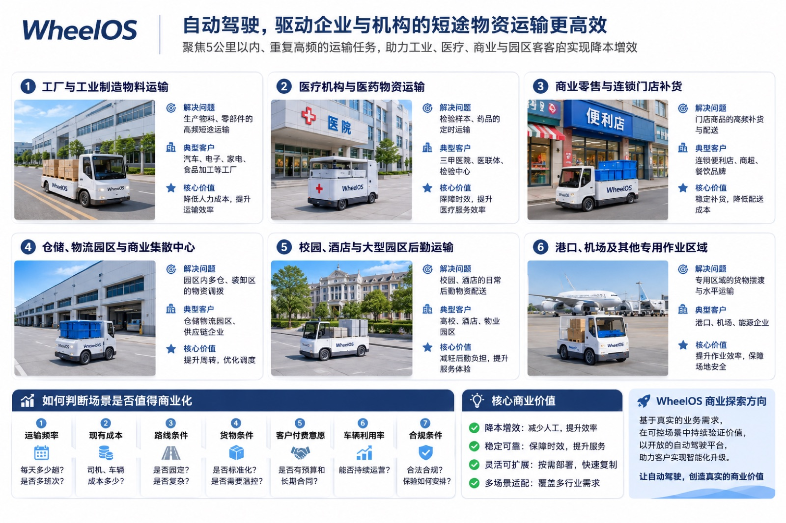
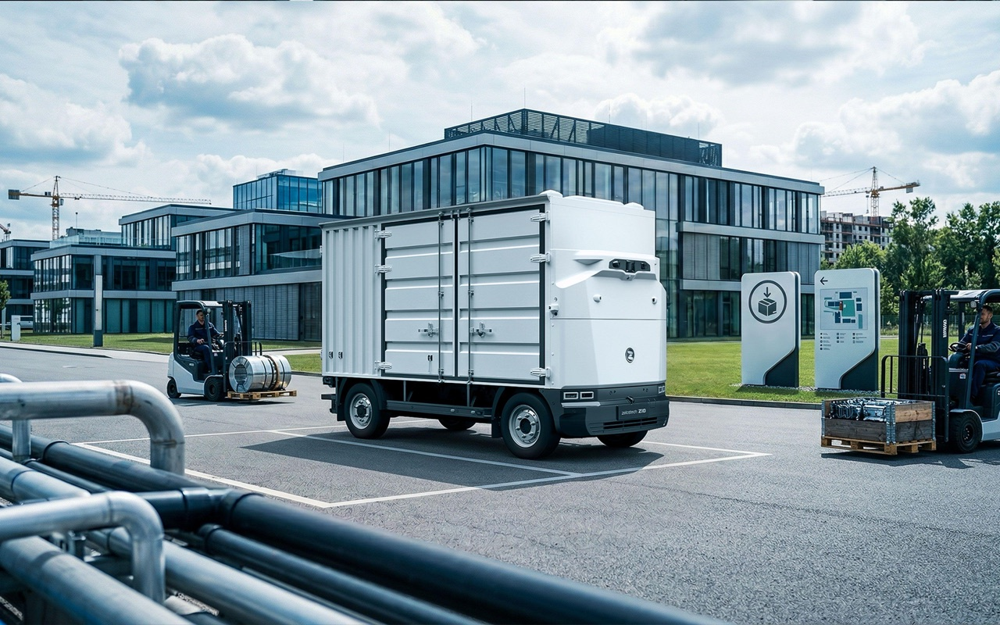
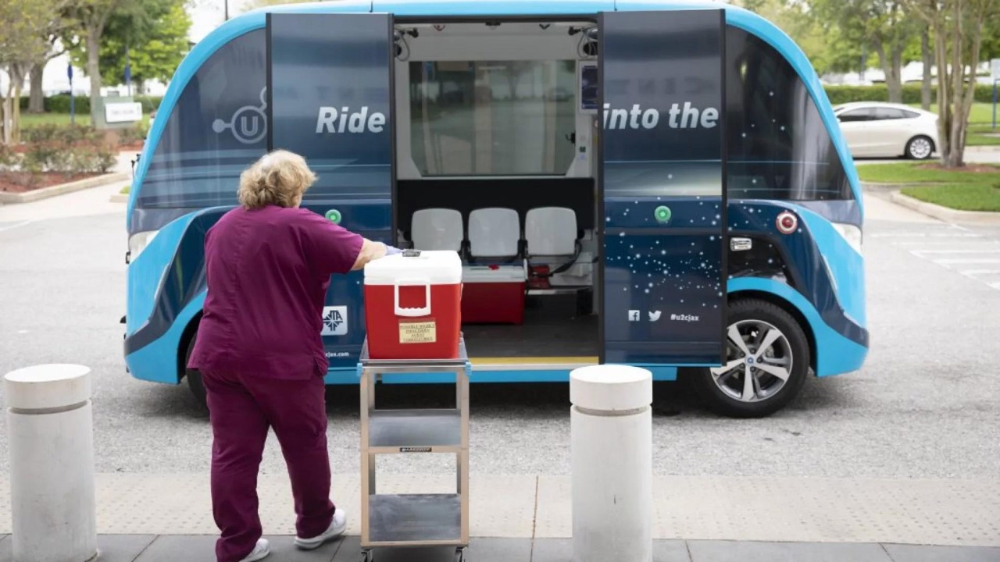
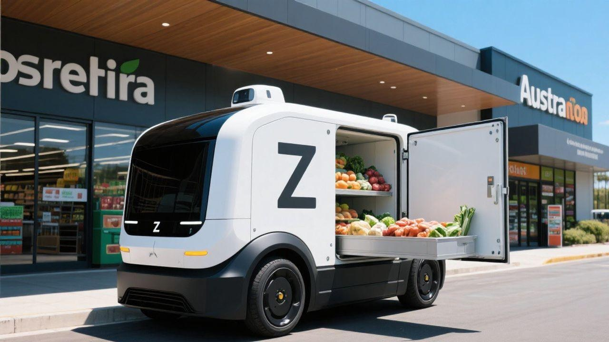
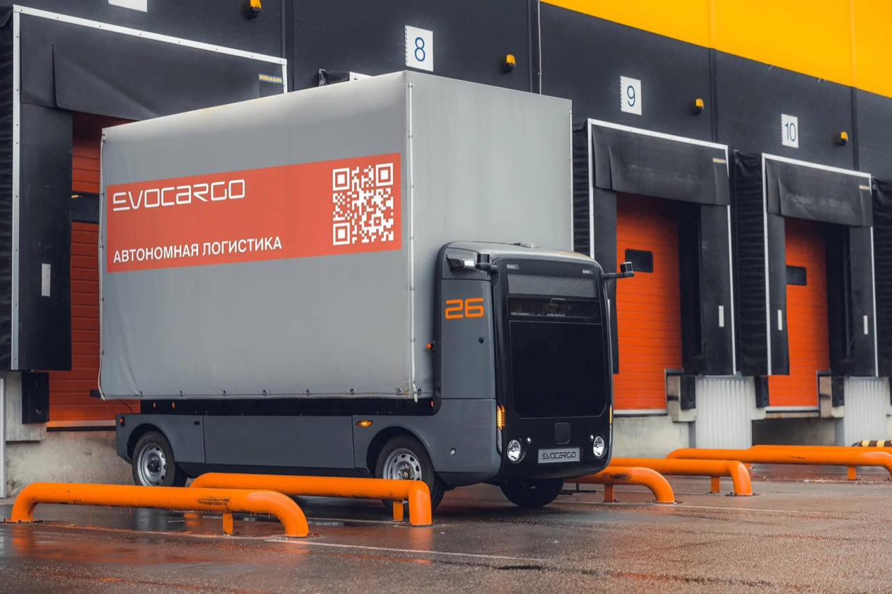
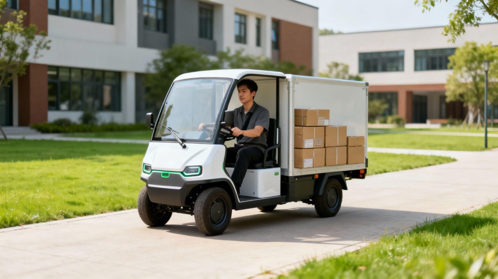
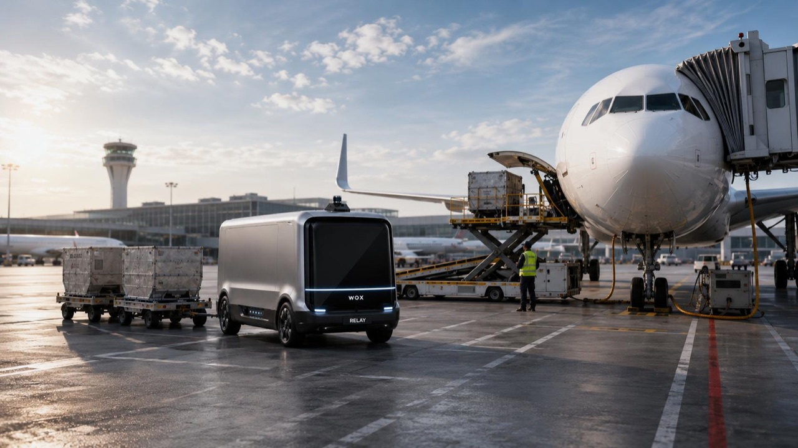

# 自动驾驶短途运输应用场景

> 本页是场景筛选与商业决策指南，不是性能、合规或安全认证承诺。每个项目都需要验证场地、车辆、任务、法规和单位经济性。

<figure class="application-visual application-visual--lead">
  
  <figcaption>WheelOS 重点探索工业、医疗、零售、仓储与大型园区之间的固定短途运输。</figcaption>
</figure>

## 先看结论

WheelOS 聚焦企业内部的**高频、重复、短距离物资运输**。最适合起步的不是“所有无人驾驶”，而是同时具备以下条件的具体运输任务：

- 单程通常不超过约 5 公里，以园区内部、相邻院区或仓库周边为主。
- 每天重复发生，有稳定班次和明确运营主体。
- 起终点、装卸区和交接流程相对固定。
- 路线、车辆、货物、法规和保险边界可以被明确评估。

**5 公里是当前重点探索范围，不是技术应用的绝对距离限制。**

[用五步判断工具检查你的运输任务 →](/solutions/fit-assessment)

## 六类场景的进入优先级

| 场景 | 客户任务 | 主要价值 | 建议优先级 | 必须先验证 |
| --- | --- | --- | --- | --- |
| 工业制造 | 仓库、车间、产线、成品库之间的物料运输 | 多班次运输、人员投入和车辆调度 | 优先探索 | 室外跨厂房路线、底盘、装卸节拍、安全混行 |
| 医疗物资 | 院区、检验中心、医联体之间的样本与物资运输 | 固定时限、重复往返和交接记录 | 高价值但强合规 | 运输资质、温控、生物安全、包装、全程交接 |
| 商业零售 | 区域仓、配送中心到周边门店的小批量补货 | 多频次补货、门店库存和配送组织 | 区域内先试点 | 门店线路密度、装卸窗口、冷链、城市混行 |
| 仓储物流园区 | 仓库之间、月台与暂存区之间的调拨 | 车辆集中调度、减少短驳人员和车辆空驶 | 较适合 | 园区地图、交通规则、月台节拍、系统接口 |
| 校园与大型园区 | 餐食、布草、耗材等多类后勤运输 | 多任务合并、提高单车利用率 | 需聚合任务 | 任务频率、多楼宇交接、物业运营主体、人车混行 |
| 港口机场与专用区域 | 固定货物摆渡和水平运输 | 大规模、固定区域、专用作业 | 后续项目制 | 专用车辆、场地系统、安全准入、长期运维 |

## 场景一：工业制造物料运输

<figure class="application-visual">
  
  <figcaption>工厂仓库、车间、产线和成品库之间的物料运输。</figcaption>
</figure>

**问题：** 原材料、零部件和半成品在仓库、车间和产线之间持续流动，部分路线很短但班次频繁。

**典型客户：** 汽车零部件、电子制造、家电、机械加工、食品加工企业和工业产业园。

**价值指标：** 每班次运输任务数、司机/搬运人员投入、车辆等待时间、准点率、单位运输成本、夜间和跨车间运输能力。

**商业模式：** 系统采购与车辆适配；固定线路月度服务；按车辆或班次提供自动驾驶系统与运维；客户或物流承包商采购车辆。

**进入条件：** 优先选择室外跨厂房、仓库到车间、跨区域固定线路。任务节拍和装卸流程应从生产计划中可获取，而不是临时调度。

## 场景二：医疗与医药物资运输

<figure class="application-visual">
  
  <figcaption>院区与检验中心之间的样本和医疗物资运输；实际业务须满足专业合规要求。</figcaption>
</figure>

**问题：** 医院、检验中心和医联体之间需要高频、小批量、定时运输样本和物资。

**典型客户：** 医院集团、医联体、第三方医学检验中心、医药商业配送企业和社区卫生服务中心。

**价值指标：** 固定时限达成率、每日往返次数、交接完整性、异常响应时间、人工取送投入。

**商业模式：** 固定线路运输合同、按班次或服务量结算、第三方医疗物流服务商采购技术能力、多院区统一运输服务。

**进入条件：** 必须由合规客户或合作运输主体负责运输资质、温控、生物安全、包装、全过程交接和应急处理。自动驾驶系统不能替代这些专业要求。

## 场景三：商业零售与连锁门店补货

<figure class="application-visual">
  
  <figcaption>区域仓、配送中心和周边门店之间的小批量补货。</figcaption>
</figure>

**问题：** 区域仓或配送中心需要向周边门店持续补货，小批量、多频次配送增加组织成本。

**典型客户：** 连锁便利店、生鲜连锁、商超集团、餐饮连锁、中央厨房和供应链企业。

**价值指标：** 配送及时率、门店缺货率、单次配送成本、装载率、车辆周转次数、门店等待时间。

**商业模式：** 固定门店线路服务、按门店/班次/任务计费、车辆租赁或运力使用时间计费、连锁企业统一采购运力。

**进入条件：** 优先评估仓库周边约 5 公里内、可形成线路集群的门店。需要明确装卸窗口、冷链要求、门店交接和城市道路运行边界。

## 场景四：仓储与物流园区内部运输

<figure class="application-visual">
  
  <figcaption>仓库、装卸月台和暂存区之间的园区短驳。</figcaption>
</figure>

**问题：** 多个仓库、装卸月台、暂存区和入驻企业之间存在持续短驳需求。

**典型客户：** 仓储运营商、物流园区、批发市场、供应链公司、保税区企业和区域配送中心。

**价值指标：** 调拨次数、月台等待、车辆空驶、统一调度车辆数、任务完成率。

**商业模式：** 固定线路和周期服务、按每日任务或周转量结算、园区统一采购、园区建设共享运输服务。

**进入条件：** 园区应有相对稳定的地图、交通规则和作业接口。客户集中、任务可统一调度时更适合形成运营闭环。

## 场景五：校园、酒店与大型园区后勤

<figure class="application-visual">
  
  <figcaption>食堂、洗涤中心、仓库和不同楼宇之间的后勤运输。</figcaption>
</figure>

**问题：** 餐食、布草、耗材和设备在楼宇、食堂、仓库和服务区之间持续运输，但单项任务频率可能不高。

**典型客户：** 高校、医院园区、酒店集团、度假区、景区、物业公司和产业园运营方。

**价值指标：** 合并后的任务密度、单车日利用率、跨楼宇交接次数、人工搬运投入。

**商业模式：** 物业或园区统一采购、月度运输服务、多任务整合服务、按线路和作业时段收费。

**进入条件：** 先把餐食、布草、耗材等多项任务组合，证明单车利用率；避免为低频单一业务单独部署车辆。

## 场景六：港口、机场与专用作业区域

<figure class="application-visual">
  
  <figcaption>港口、机场和专用作业区域内的固定线路运输。</figcaption>
</figure>

**问题：** 港口、机场、铁路货场和能源基地内部存在固定货物摆渡和水平运输。

**典型客户：** 港口、机场、铁路货运中心、能源企业和专用场地运营商。

**价值指标：** 固定区段运输量、车辆利用率、调度集成、停机时间、安全事件和全天候运营能力。

**商业模式：** 项目制系统集成、专用车辆适配、自动驾驶系统授权和长期运维。

**进入条件：** 通常涉及专用车辆、场地作业系统、安全准入和复杂调度，适合作为后续重点客户，而不是早期唯一市场。

## 商业模式

商业模式应与车辆所有者、运营主体、承运责任和客户预算匹配。以下是可讨论的合作结构，具体责任以合同为准。

### 客户与 WheelOS 的分工

| 责任方 | 通常负责 | 不能默认承担 |
| --- | --- | --- |
| 客户 | 场地、运输任务、车辆或采购计划、装卸交接、运营团队、必要的许可和保险 | 客户业务合规、承运责任和现场运营 |
| WheelOS | 套件配置、软件与接口资料、集成支持、标定与验证建议、可选项报价 | 未经合同约定的物流承运或行业许可 |
| 双方共同确认 | 运行设计域、路线、验收指标、数据与日志、安全边界、项目计划和责任划分 | 任何一方不得把设计建议单方面解释为已验证安全 |

### 可选商业模式

| 模式 | 客户购买什么 | 适合的客户结构 | 关键边界 |
| --- | --- | --- | --- |
| 自动驾驶系统采购 | 车辆和系统的适配、部署与技术支持 | 自有车辆和运营团队的客户 | 明确硬件、软件、适配和支持范围 |
| 固定线路运输服务 | 按线路、班次或月度运输量提供服务 | 自有或合作运输商运营 | WheelOS 的技术与承运责任需在合同中区分 |
| 车辆租赁与运力服务 | 按租赁周期或实际使用量购买运力 | 希望减少前期资产投入的客户 | 车辆所有者、保险和事故责任必须明确 |
| 软件与运维订阅 | 自动驾驶系统、车队管理和持续运维 | 多车辆、多线路的运营方 | 功能范围、SLA 和数据责任需确认 |

## 场景准入清单

报价前至少回答：

1. 每天有多少趟任务？是否需要多班次或夜间运行？
2. 当前需要多少司机、搬运人员和车辆？
3. 线路是否固定？是否存在人车混行、临时障碍和复杂路口？
4. 货物是否标准？装卸和交接能否标准化？
5. 谁是预算和采购主体？是否有长期运营计划？
6. 单车每天能完成多少有效任务？
7. 场地或道路是否允许运行？保险、事故责任和监管要求如何安排？

以下情况不应直接进入部署：

- 任务频率低，无法形成稳定利用率。
- 没有明确的运营主体、预算或长期计划。
- 起终点、装卸和交接流程高度不确定。
- 法规、保险或场地安全责任尚未解决。
- 客户只关注“无人驾驶展示”，没有业务指标。

## WheelOS 提供什么

  

    01 / KIT
    <h3>一体化自动驾驶开发套件</h3>
    
预集成计算、传感器、组合导航、软件栈和开发工具，用于园区低速项目开发和集成。

  

  

    02 / ADAPT
    <h3>车辆与场景适配</h3>
    
围绕底盘 CAN、路线、装卸、标定和验证流程讨论项目配置与集成服务。

  

  

    03 / OPERATE
    <h3>运营能力规划</h3>
    
车辆接入、运行管理和远程监控属于项目规划范围，具体功能、SLA 和交付条件需单独确认。

  

WheelOS 不经营快递揽收、分拣、派件或快递驿站，也不替代医疗、港口、机场等行业的专业合规责任。

## 下一步

1. 提供场景、车辆、路线、班次、货物和交接方式。
2. 共同筛选任务频率、运营主体、法规和单位经济性。
3. 核对底盘、传感器布置、场地地图、安全和验收指标。
4. 在受控环境中开展最小集成与验证项目。

[查看从需求沟通到试点部署的五阶段客户流程 →](/solutions/delivery-process)

  

    <h2>判断你的运输任务是否适合自动驾驶</h2>
    
发送场景、车辆和运营数据，我们会先做适用性筛选，再讨论套件、服务和商业合作。

  

  

    <a class="primary" href="mailto:support@wheelos.cn?subject=WheelOS%20short-distance%20transport%20assessment">提交场景评估</a>
    <a href="/solutions/fit-assessment">先做五步判断</a>
    <a href="/solutions/delivery-process">查看交付流程</a>
    <a href="/solutions/integrated-autonomous-driving-kit">查看一体化套件</a>
  

